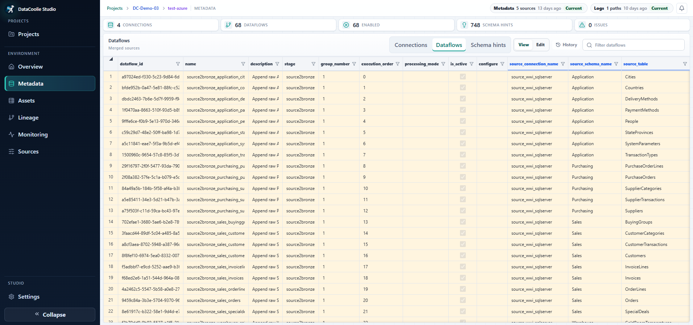
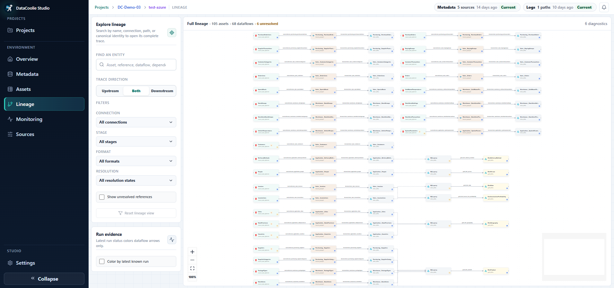
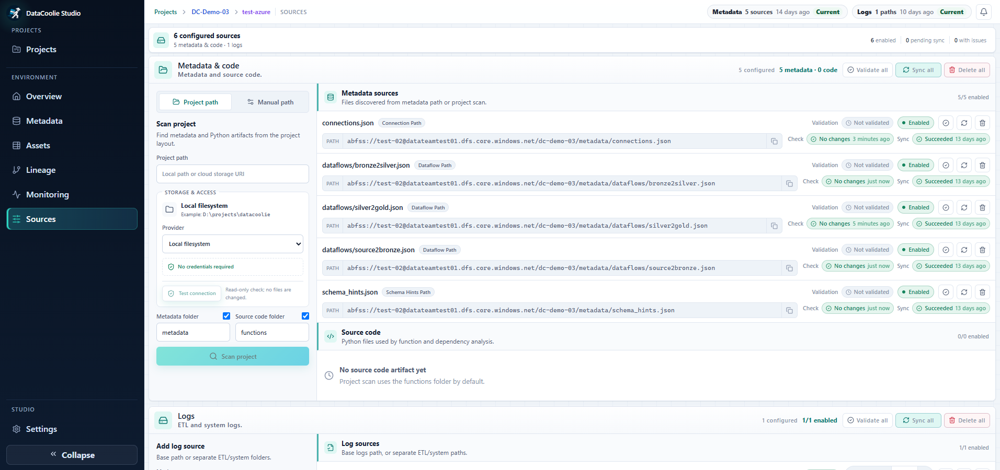
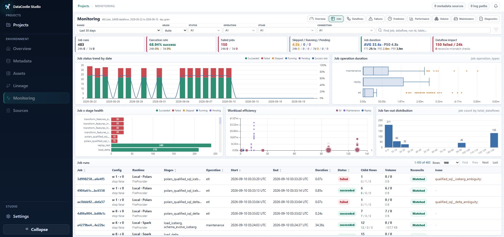
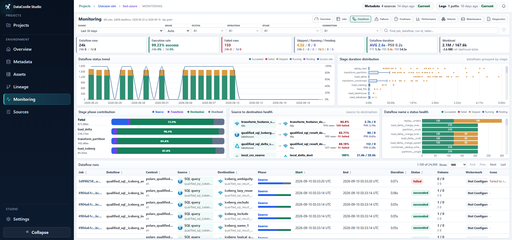
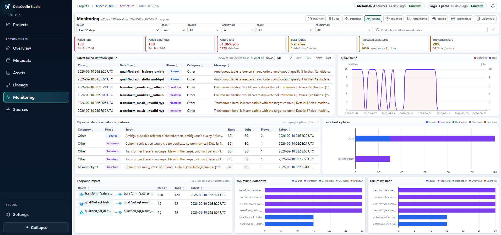
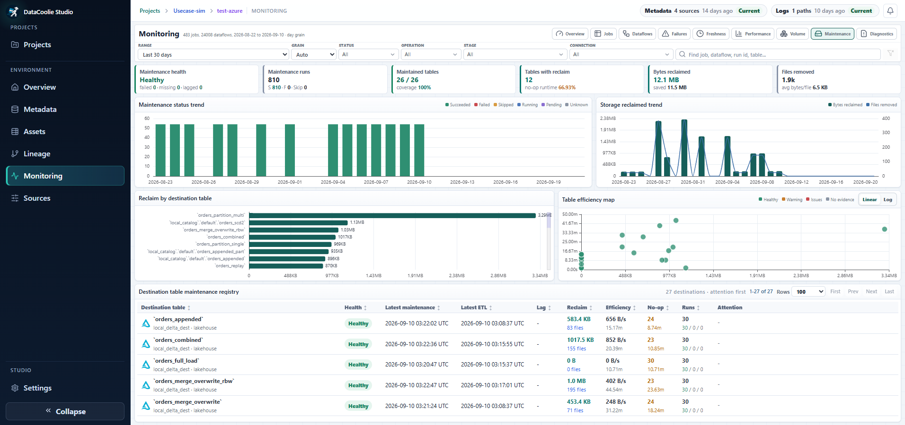

# DataCoolie Studio

DataCoolie Studio is a local web app for exploring DataCoolie projects. Use it to manage sources, edit metadata, inspect lineage, and monitor extract, transform, and load (ETL) runs.

## What you can do

- Organize sources by Project and Environment
- Read and edit metadata in `JSON`, `YAML`, or `XLSX` format
- Inspect lineage from metadata, SQL queries, and Python code
- Monitor Dataflow, Job, and System logs
- Connect to Local, S3, MinIO, ADLS, OneLake, GCS, and Databricks storage
- Store cloud credentials in the operating system credential store

Published source files remain the source of truth. Draft changes are kept in Studio until **Save to
Source** conditionally writes the source. Studio reads, displays, edits, and saves metadata; DataCoolie
validates metadata and SQL when preparing or running a pipeline. Studio checks file formats, source
revisions, write permissions, and backup integrity. Lineage combines evidence for display without
creating a merged metadata file.

See [release notes](docs/release-notes.md) for the DataCoolie 0.2 compatibility
update and the removed metadata-validation API.

Studio 0.2.x supports DataCoolie log schemas v6 and v7 for Monitoring. Older log records
are excluded with a warning; source files remain intact. Existing analytics
caches from schema17 upgrade from stored data. Optional new log fields migrate
without historical backfill; previously loaded rows receive null for those fields.
Older or incomplete caches may still require logs to rebuild.

V7 retains observed numbers, including zero, and leaves unentered or unmeasured
metrics null. Monitoring sums observed values for v7 and mixed v6/v7 populations,
with null when no measurement exists. Coverage shows measured runs against the
report population. Historical v6 values and v6-only aggregate behavior are preserved.

## Screenshots

The screenshots below show the main Studio workflow using a populated local DataCoolie environment.

### Projects and Environment

Projects provides a single workspace view for project readiness, environment navigation, and source coverage.


Environment Overview brings Metadata, Lineage, Monitoring, freshness, and next actions together in one screen.


### Metadata, Assets, Lineage, and Sources

Metadata presents connections, dataflows, schema hints, and ordered source-defined transform configuration in an editable workspace.



Assets provides an inventory of discovered assets and references, including resolution and usage context.


Lineage connects metadata, SQL, and Python evidence into an interactive graph with filters and run-status context.



Sources shows Local and cloud bindings, readable/cache status, scheduled Log refresh, and one-click path copying.



When scanning a project, Studio always uses automatic layout discovery. It
keeps the configured `functions` root and also recognizes common Python
layouts from a root `pyproject.toml`. A project with `src/<package>/**/*.py`
is indexed with import names such as `package.module`, without executing or
installing the project. `.py`, `.zip`, and `.whl` files found below the code
root become separate code artifacts, so their provenance and validation state
remain independent. Unsupported or ambiguous namespace layouts are reported
for manual module-root/module-prefix configuration. The API still accepts
`code_discovery_mode=explicit` for advanced integrations that need to limit a
scan to the configured folder.

### Monitoring

Monitoring is split into nine focused pages so operational questions can be answered without leaving the Environment.

<details>
<summary>Open all 9 Monitoring pages</summary>

<table width="100%">
<tr>
<td valign="top" width="50%"><strong>Overview</strong><br><sub>Health KPIs, trends, runtime context, and attention signals.</sub><br></td>
<td valign="top" width="50%"><strong>Jobs</strong><br><sub>Job status, duration, runtime context, and drill-in evidence.</sub><br></td>
</tr>
<tr>
<td valign="top"><strong>Dataflows</strong><br><sub>Dataflow filtering, execution status, timings, and source/destination context.</sub><br></td>
<td valign="top"><strong>Failures</strong><br><sub>Failure categories, repeated failures, and investigation entry points.</sub><br></td>
</tr>
<tr>
<td valign="top"><strong>Freshness</strong><br><sub>Source freshness, event time, watermarks, and stale-data signals.</sub><br></td>
<td valign="top"><strong>Performance</strong><br><sub>Duration percentiles, phase contribution, pressure, and candidates.</sub><br></td>
</tr>
<tr>
<td valign="top"><strong>Volume</strong><br><sub>Rows, bytes, files, workload trends, and file-churn candidates.</sub><br></td>
<td valign="top"><strong>Maintenance</strong><br><sub>Maintenance operations, destination impact, and performance signals.</sub><br></td>
</tr>
<tr>
<td valign="top"><strong>Diagnostics</strong><br><sub>Bounded diagnostic aggregates and investigation evidence.</sub><br></td>
<td valign="top"></td>
</tr>
</table>

</details>

## Install and run

DataCoolie Studio requires Python 3.11 or later.

```powershell
pip install datacoolie-studio
datacoolie-studio
```

The launcher starts Studio at `http://127.0.0.1:8765`, creates its local workspace on first run, and opens your browser. On a wide interactive terminal it prints a large `DataCoolie` wordmark, links to the DataCoolie and DataCoolie Studio repositories, and the URL it is starting. Narrow terminals and redirected output use a compact version of the introduction.

Use `--no-banner` when only the server logs are needed:

```powershell
datacoolie-studio --no-banner
```

The startup introduction looks like this:

```text
 ____        _         ____            _ _
|  _ \  __ _| |_ __ _ / ___|___   ___ | (_) ___
| | | |/ _` | __/ _` | |   / _ \ / _ \| | |/ _ \
| |_| | (_| | || (_| | |__| (_) | (_) | | |  __/
|____/ \__,_|\__\__,_|\____\___/ \___/|_|_|\___|

Studio v<version>
Explore DataCoolie metadata, lineage, and execution/system logs.

DataCoolie - Metadata-driven ETL framework
  https://github.com/datacoolie/datacoolie
DataCoolie Studio - Local web app for DataCoolie projects
  https://github.com/datacoolie/datacoolie-studio

Starting at: http://127.0.0.1:8765
Press Ctrl+C to stop.
```

Install only the cloud integrations you need:

```powershell
pip install "datacoolie-studio[s3]"
pip install "datacoolie-studio[minio]"
pip install "datacoolie-studio[adls]"
pip install "datacoolie-studio[onelake]"
pip install "datacoolie-studio[gcs]"
```

Databricks SDK support is included in the base installation. Use
`pip install "datacoolie-studio[cloud]"` to install every other cloud
integration. For a complete environment with every cloud integration and
the development, test, and packaging tools, use:

```powershell
pip install "datacoolie-studio[all]"
```

## Create your first workspace

1. Create a **Project**
2. Add an **Environment** such as `dev`, `test`, or `prod`
3. Add a metadata file or scan a DataCoolie project
4. Add execution and system logs for Monitoring
5. Add Python code artifacts when metadata references Python functions
6. Open **Metadata**, **Assets**, **Lineage**, or **Monitoring**

Metadata is required. Logs and code artifacts are optional.

## Source roots and editing

When you scan a source, provide the project or environment root that already
contains the relevant `metadata`, `sql`, and `functions` folders. Studio uses
`datacoolie.yml` first, then an environment `manifest.json`; each declared
component path overrides its default independently. If neither marker exists,
the configured defaults (`metadata`, `sql`, `functions`) are used. A build
manifest is not an environment root, so pass `<artifact>/<environment>/`
instead.

SQL references can be inline or backed by a `.sql` file. Leave **File path**
empty for inline SQL; enter a path under a configured SQL root (or an
`artifact:/...` path) when the query should be saved as a file. **Save Draft**
updates Studio's workspace only. **Save to Source** creates or overwrites the
physical SQL file; it does not automatically delete or move an older file.

Logs use `log_base_path` with separate `execution_logs` and `system_logs`
streams. Dataflow and job records are shown in execution monitoring; system
records can additionally show `event_name` and `dataflow_run_id` context. The
`log_schema_version` field is preserved as ordinary record metadata; Studio
does not require a fixed numeric value for discovery or ingestion. DataCoolie
and Studio should stay in the same `0.2.x` compatibility family, while their
patch versions may differ.

## Configure Studio

Studio stores persistent local state under `~\.datacoolie\datacoolie-studio\`
by default. Set `--data-dir` or `DATACOOLIE_STUDIO_DATA_DIR` to move the
entire local root:

```text
<data-dir>/
db\studio.db
backups\
cache\read-models.sqlite3
cache\analytics.duckdb
cache\source-materializations\
logs\
```

Common launcher options:

```powershell
datacoolie-studio --port 8765
datacoolie-studio --host 127.0.0.1
datacoolie-studio --data-dir .\.scratch\datacoolie-studio
datacoolie-studio --database-url "sqlite:///D:/data/datacoolie-studio/db/studio.db"
datacoolie-studio --result-cache-url "sqlite:///D:/data/datacoolie-studio/cache/read-models.sqlite3"
datacoolie-studio --no-open
```

You can also configure storage with environment variables:

| Variable | Purpose |
|---|---|
| `DATACOOLIE_STUDIO_DATA_DIR` | Persistent local root for the workspace database, result cache, analytics cache, backups, logs, and source materializations |
| `DATACOOLIE_STUDIO_DATABASE_URL` | Workspace SQLite database URL; defaults to SQLite under `DATA_DIR` |
| `DATACOOLIE_STUDIO_RESULT_CACHE_URL` | Result-cache URL; currently SQLite or `memory://`, defaulting to SQLite under `DATA_DIR` |
| `DATACOOLIE_STUDIO_HOST` | Bind host; defaults to `127.0.0.1` |
| `DATACOOLIE_STUDIO_PORT` | Bind port; defaults to `8765` |
| `DATACOOLIE_STUDIO_ANALYTICS_DUCKDB_THREADS` | `auto` (default): `min(detected CPU allocation, 4)`, including affinity and visible Linux container quotas; or an explicit positive thread count |
| `DATACOOLIE_STUDIO_ANALYTICS_DUCKDB_MEMORY_LIMIT` | `auto` (default): 70% of detected physical RAM, bounded by visible Linux container limits; or an explicit size such as `4GiB` |
| `DATACOOLIE_STUDIO_ANALYTICS_DUCKDB_TEMP_DIRECTORY` | Disk spill directory; defaults to `cache/analytics-tmp` under `DATA_DIR` |

The **DuckDB budget** in Settings shows these effective limits. Auto uses at most
4 query threads and has no fixed 8GB memory cap. It reserves memory headroom for Studio and other work;
the memory limit controls DuckDB's buffer manager, rather than total process
memory, and does not allocate that RAM immediately. If memory detection is
unavailable, auto falls back to `1GB`. Explicit overrides take precedence over
auto detection. Restart Studio after changing environment variables. Log-loading
worker concurrency is configured separately from DuckDB query threads.

CLI values take precedence over environment variables. The Studio workspace
database currently supports synchronous SQLite URLs only, such as
`sqlite:///D:/data/datacoolie-studio/db/studio.db`. PostgreSQL, MySQL, and other
database types remain available as user-configured source systems; they are not
storage engines for Studio's own workspace state. The result-cache provider
currently accepts SQLite URLs and `memory://`; remote Redis/PostgreSQL result
cache backends are not enabled.

`--db` and `DATACOOLIE_STUDIO_DB` are not part of the current configuration
contract. Configure a local deployment with `--data-dir` or
`DATACOOLIE_STUDIO_DATA_DIR`; use `--database-url` or
`DATACOOLIE_STUDIO_DATABASE_URL` only when an explicit workspace database URL
is required.

Studio is a local application without built-in authentication. Keep the default
`127.0.0.1` bind address. Binding to a network interface exposes the workspace
and its APIs to anyone who can reach that address; shared multi-user hosting
is not supported.

## Develop from source

Run the backend directly from `src`. This assumes the active Python environment already contains the dependencies declared in `pyproject.toml`.

```powershell
$env:PYTHONPATH = "$PWD\src"
python -m uvicorn datacoolie_studio.main:app `
  --reload `
  --host 127.0.0.1 `
  --port 8765
```

Run the frontend in another terminal:

```powershell
cd frontend
npm install
npm run dev
```

Open `http://127.0.0.1:5173`. Vite sends API requests to the backend at `http://127.0.0.1:8765`.

Build the frontend into the Python package:

```powershell
cd frontend
npm run build
```

Run repository checks:

```powershell
.\scripts\verify.ps1
.\scripts\verify.ps1 -Mode Full
.\scripts\verify.ps1 -Mode Release
```

The default Fast check runs backend lint, focused architecture and startup tests,
and OpenAPI/generated API checks. Full mode runs the complete local backend and
frontend suites, builds the frontend, and audits frontend dependencies. Release
mode also checks the Python lockfile and audits its dependencies, builds and
checks the distributions, and smoke-tests the installed wheel. Install the
`dev` or `all` extra to provide the verification tools.
